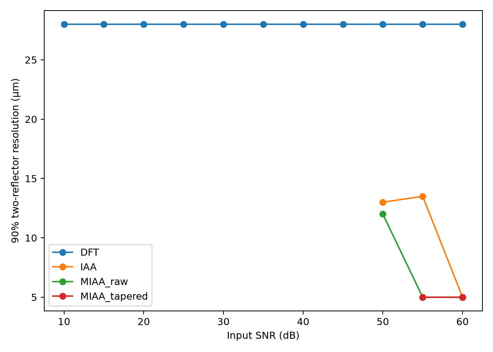
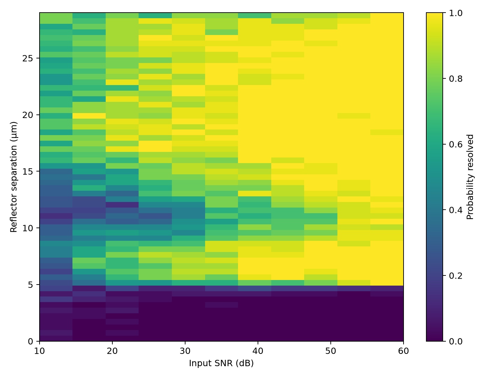
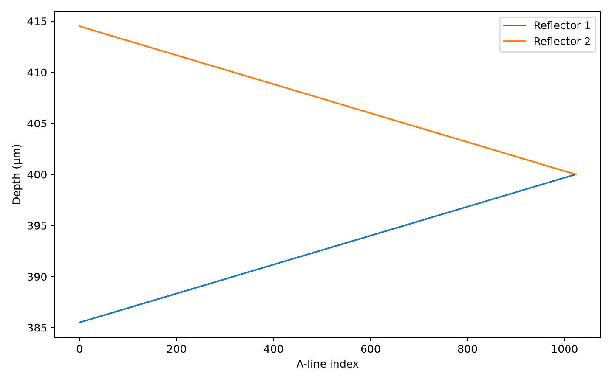
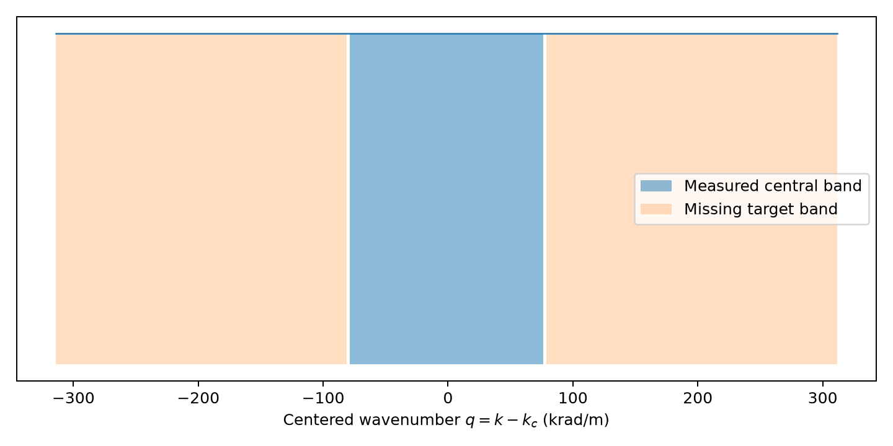
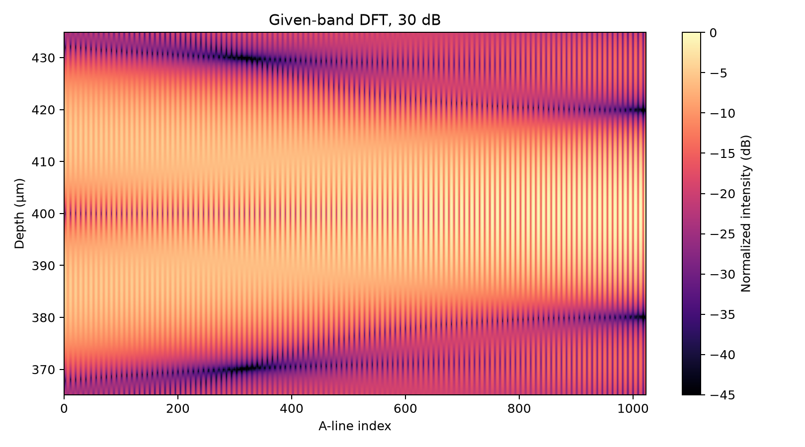
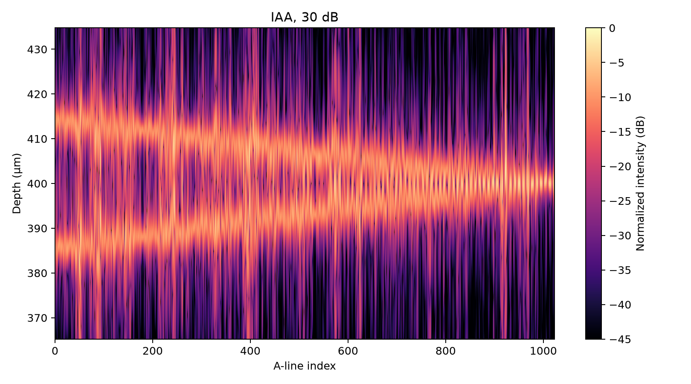
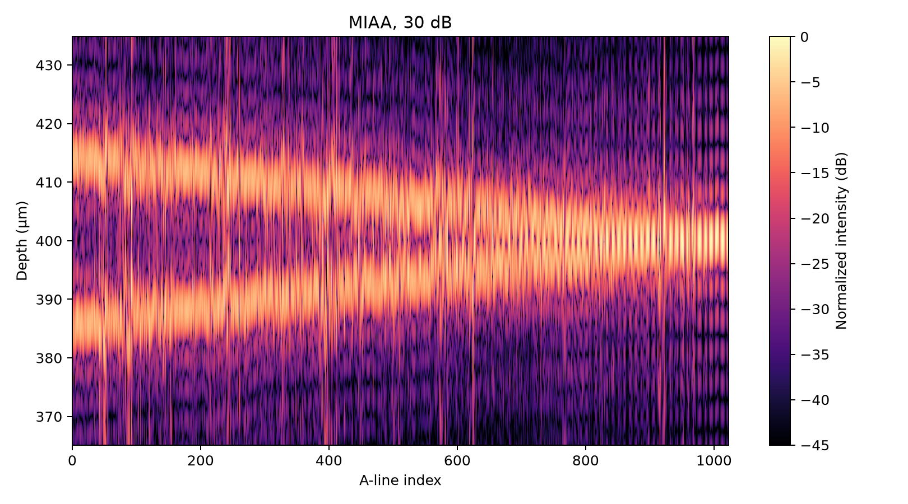
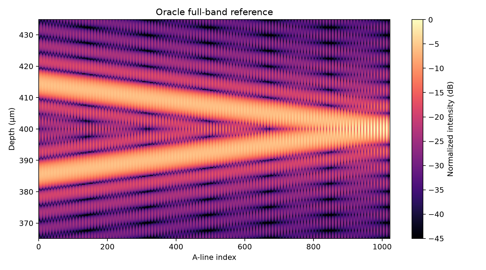

# MIAA super-resolution for OCT — a synthetic wedge simulator

**How much signal-to-noise ratio do you have to pay to buy axial resolution you never measured?**

Optical coherence tomography resolves depth by interference, and its axial resolution is set by the
optical bandwidth you can actually record: for a source of width Δλ centred at λ₀, two equal
reflectors are separated by roughly `Δz ≈ λ₀² / (2Δλ)`. Detector arrays and source tuning ranges cap
Δλ, so that limit looks like hardware.

The Missing-data Iterative Adaptive Approach (MIAA) attacks it in software. It fits an adaptive
reflectivity model to the band you *did* measure, then uses that model to **predict the spectral
samples you never recorded**, reconstructing as if the bandwidth were wider. This repository
implements IAA and MIAA from scratch, builds a controlled synthetic OCT experiment around them, and
measures what the trick actually costs.

**Result: it works, and the price is SNR.** With a 4× virtual bandwidth extension, MIAA reaches
5 µm resolution at 55 dB — where the conventional DFT is stuck at 28 µm regardless of SNR, and where
plain IAA on the measured band still needs 60 dB. Below 45 dB no adaptive method resolves anything
reliably at all.

| | |
|---|---|
| **Context** | Research internship, Computational Optics for Biophotonic Imaging (COBI) Lab, DGIST |
| **Period** | July – August 2026 · Advisor: Prof. Byungkun Lee |
| **Stack** | Python · NumPy · SciPy (Cholesky solves) · pandas · Matplotlib · pytest |
| **Experiment size** | 11 SNR levels × 59 separations × 30 noise seeds × 4 methods |
| **Write-up** | [`docs/MIAA_OCT_report.pdf`](docs/MIAA_OCT_report.pdf) — IEEE-style paper with full derivations |
| **Operator guide** | [`docs/RUNBOOK.md`](docs/RUNBOOK.md) — file-by-file map and the maths as implemented |

---

## 1. Headline result



90 %-reliable two-reflector resolution, in micrometres — lower is better. Blank means *never resolved
at any tested separation*:

| SNR | DFT (given band) | IAA | **MIAA** | MIAA + taper |
|---:|---:|---:|---:|---:|
| ≤ 45 dB | 28 µm | — | — | — |
| 50 dB | 28 µm | 13 µm | **12 µm** | — |
| 55 dB | 28 µm | 13.5 µm | **5 µm** | 5 µm |
| 60 dB | 28 µm | 5 µm | **5 µm** | 5 µm |

Three things are worth reading off that table.

**DFT resolution is flat.** 28 µm at 10 dB, 28 µm at 60 dB. A sinc-squared point-spread function
does not care how clean your data is — the bandwidth decides, full stop. Every bit of improvement
below is bought by *modelling*, not by averaging.

**There is a hard SNR floor.** Below 45 dB, neither IAA nor MIAA achieves 90 % resolution at any
separation. Super-resolution is not free: the information it exploits is buried under the noise, and
below the floor the method confidently fits noise instead.

**MIAA saturates exactly where theory says it should.** 5 µm is the Rayleigh limit of the 4×-extended
virtual band. MIAA buys you the resolution of a bandwidth you never measured — and not one
micrometre more.

Supporting metrics: missing-spectrum NMSE improves from about −2 dB at 10 dB SNR to −16 dB at 60 dB;
localisation RMSE stays under 1 µm for well-separated reflectors at ≥ 55 dB; amplitude-ratio error
stays under 1 dB above the resolution threshold.



---

## 2. The experiment

### 2.1 Wedge geometry

Two equal-amplitude point reflectors sit symmetrically about a centre depth of 400 µm, and their
separation shrinks linearly from 29 µm to 0 across a 1024-A-line B-scan — a wedge. Somewhere along
that wedge each method fails, and *where* it fails is the measurement.



### 2.2 Measured versus missing spectrum

The measured band is 6.5 nm wide at a 510 nm centre wavelength, sampled at 64 points. It is placed in
the **centre** of a 256-point grid, so 192 samples — 96 on each side — are missing. That is a 4×
virtual bandwidth extension, from 6.5 nm to roughly 26 nm.



### 2.3 Four methods, compared on identical data

| Method | What it sees | Role |
|---|---|---|
| **Given-band DFT** | measured 64 samples, zero-padded | the baseline you get today |
| **IAA** | measured 64 samples | adaptive, but no bandwidth extension |
| **MIAA** | measured 64 + 192 predicted | the method under test |
| **Oracle full-band DFT** | the true 256-sample spectrum | an upper bound, *not* an achievable measurement |

The oracle matters: without it, you cannot tell whether MIAA is recovering real structure or merely
inventing plausible-looking peaks.

### 2.4 One A-line, 30 dB SNR

Reconstructed B-scans at 30 dB. The DFT merges the reflectors long before MIAA does:

| DFT | IAA | MIAA | Oracle |
|---|---|---|---|
|  |  |  |  |

---

## 3. Method, as implemented

### 3.1 Signal model

For reflectors at depths `z_j` with complex amplitudes `a_j`, on the centred wavenumber grid
`q = k − k_c`:

```
y(q_n) = Σ_j a_j · exp(−i·2·q_n·z_j)
```

The round-trip carrier phase `exp(−i·2·k_c·z_j)` is folded into each amplitude, which keeps the model
phase-consistent while letting `q` stay a baseband coordinate. The wavelength-to-wavenumber mapping
is nonlinear and is computed as such — `Δk = 2π/λ_short − 2π/λ_long`, giving
δq = 2453 rad/m across 64 samples.

### 3.2 Exact SNR

Noise is circular complex Gaussian, and the realisation is **rescaled after generation** so that
every single trial sits at the requested SNR to numerical precision:

```
SNR_dB = 10·log₁₀( mean(|y_clean|²) / mean(|noise|²) )
```

This is a deliberate choice. Statistical SNR would smear the resolution-versus-SNR curve with
accidental SNR variation; the question here is how reconstruction behaves at a *given* SNR, so that
variable is pinned down.

### 3.3 IAA

Initialise from the zero-padded DFT, `a⁽⁰⁾ = F_gᴴ y_g / N_g`, then iterate:

```
R_g = F_g · diag(|a|²) · F_gᴴ + σ² I
a_l = (f_lᴴ R_g⁻¹ y_g) / (f_lᴴ R_g⁻¹ f_l)
```

Linear systems are solved by **Cholesky factorisation** — the code never forms `R_g⁻¹` explicitly,
which is both faster and better conditioned. The implementation is brute-force (no fast IAA
recursion) on purpose: this study is about accuracy versus SNR, and a transparent implementation is
easier to trust than a fast one. The injected noise variance is handed to IAA rather than estimated,
so the result measures IAA/MIAA performance and not a separate noise-estimation error.

### 3.4 MIAA

Once IAA has converged on the measured band, the MMSE missing-data expression extrapolates:

```
v   = R_g⁻¹ y_g
c_l = |a_l|² · (f_g,lᴴ v)
y_m = F_m · c
```

The final spectrum keeps the **actual noisy measured samples** in the central band and uses
predictions *only* at missing indices. Nothing measured is ever overwritten by the model.

### 3.5 When does "resolved" count?

A pair is resolved only if all three hold:

1. two peaks are detected near the two known depths;
2. both lie within the localisation tolerance (5 µm);
3. the valley between them satisfies `valley ≤ 0.5 · min(peak₁, peak₂)` — the 3 dB criterion.

The 90 % threshold is found by sweeping from large separation down to small and stopping at the first
loss of reliable resolution, rather than taking the smallest separation that happened to succeed.
Coherent two-reflector fringes beat against each other, so success is not monotone in separation and
an isolated lucky point is not a resolution limit.

---

## 4. Running it

```bash
python -m venv .venv
source .venv/bin/activate          # Windows: .venv\Scripts\activate
python -m pip install -r requirements.txt
python -m pip install -e . --no-build-isolation
python -m pytest -q
```

Quick pass first — small matrices, three noise seeds, a few minutes:

```bash
python scripts/00_plot_simulation_setup.py   --config config_quick.yaml
python scripts/01_validate_single_reflector.py --config config_quick.yaml --snr 50
python scripts/02_validate_two_reflectors.py   --config config_quick.yaml --snr 50
python scripts/03_generate_wedge_bscan.py      --config config_quick.yaml --snrs 10 30 50
python scripts/04_run_snr_sweep.py             --config config_quick.yaml --separation-step-um 2
python scripts/05_make_report_figures.py
```

On Windows, `.\run_quick.ps1` runs that whole sequence.

The full experiment — 11 SNR levels, separations from 0 to 29 µm in 0.5 µm steps, 30 seeds — is
`.\run_final.ps1` (or the same scripts with `--config config_final.yaml`). Brute-force IAA at this
scale takes hours on a CPU. Every parameter lives in `config_final.yaml`; nothing is hard-coded in
the scripts.

[`docs/RUNBOOK.md`](docs/RUNBOOK.md) documents every module and script, and restates the maths in the
form the code implements it.

---

## 5. Repository layout

```
src/miaa_oct/
  config.py          loads and validates the YAML parameters
  grids.py           centred wavenumber grid, measured/missing index split, Fourier dictionaries
  fringe.py          synthesises the analytic fringe; builds the wedge trajectories
  noise.py           complex AWGN at an exact requested power SNR
  iaa.py             brute-force IAA with Cholesky solves
  miaa.py            the MMSE missing-data extrapolation
  reconstruction.py  centred zero padding, inverse FFT, spectral tapering
  metrics.py         missing-spectrum NMSE; 3 dB valley criterion; localisation checks
  pipeline.py        one noisy A-line through all four methods
  plotting.py        A-line and B-scan figures on a shared dB scale

scripts/00…05        setup plots → single-reflector check → two-reflector check →
                     B-scans → Monte Carlo sweep → report figures
tests/test_core.py   grid shapes, exact-SNR scaling, and the reconstruction invariants
results/figures      21 figures from the final run
results/tables       snr_sweep.csv (raw), snr_sweep_summary.csv, resolution_90.csv
docs/                the paper, and the operator runbook
config_*.yaml        quick / final / default parameter sets
```

Raw `wedge_*.npz` arrays (about 200 MB each) are not committed; `scripts/03_generate_wedge_bscan.py`
regenerates them.

---

## 6. Scope and honest limits

- **Synthetic data only.** Point reflectors, no scattering, no dispersion, no sample motion.
  Resolution numbers here are an upper bound on what the same code would do on real fringes.
- **The noise variance is given, not estimated.** Deliberate, as explained in §3.3, but a real
  instrument has to estimate it, and that error is not in these curves.
- **Brute-force IAA.** Chosen for transparency over speed. A production implementation would use the
  fast recursive form.
- **Two reflectors, equal amplitude.** The cleanest case for a resolution metric, and the easiest.

---

## 7. References

1. Zhu *et al.*, iterative adaptive approach applied to OCT depth reconstruction.
2. Missing-data IAA (MIAA) and the MMSE spectral-extrapolation formulation.
3. Standard OCT axial-resolution theory, `Δz ≈ λ₀²/(2Δλ)`.

Full citations are in [`docs/MIAA_OCT_report.pdf`](docs/MIAA_OCT_report.pdf).

---

## 8. Licence and provenance

Code and write-up: **MIT licence** — see [`LICENSE`](LICENSE).

This is an independent from-scratch implementation of published algorithms, run entirely on
synthetic data. It contains no measured data, instrument parameters or unpublished results from the
COBI Lab; the lab is credited as the context in which the work was done.

---

**Begaly Berimbay** — B.S. Electronics Engineering & Computer Science, DGIST
