# Performance of Missing-Data IAA Versus SNR in Synthesized Two-Reflector OCT Wedge Scans

---

**Abstract** — This paper reports a simulator study of the Missing-data Iterative Adaptive Approach (MIAA) applied to synthetic OCT fringes generated from two equal-amplitude point reflectors whose axial separation decreases linearly across a 1024-A-line B-scan. Four reconstruction methods are compared: given-band DFT, IAA, MIAA without tapering, and MIAA with squared-cosine edge tapering. A Monte Carlo sweep over 11 SNR levels from 10 dB to 60 dB, with 30 independent noise realizations per condition, yields resolution probability curves, 90%-threshold maps, missing-spectrum NMSE, localization RMSE, and amplitude ratio error. The measured bandwidth of 6.5 nm at a 510 nm center wavelength is extrapolated by a factor of four (64 → 256 spectral samples) to a synthesized 26 nm bandwidth. DFT resolution is SNR-independent and stalls at 28 µm, matching the sinc-squared Rayleigh limit of the 6.5 nm band. MIAA first reaches 90% two-reflector resolution at 50 dB SNR (12 µm) and achieves 5 µm at 55 dB, saturating at the 4× extrapolation Rayleigh limit. IAA on the given band alone requires 60 dB to reach 5 µm. Below 45 dB none of the adaptive methods achieves 90% resolution at any tested separation. Missing-spectrum NMSE improves from approximately −2 dB at 10 dB SNR to −16 dB at 60 dB. Localization RMSE stays below 1 µm for well-separated reflectors at SNR ≥ 55 dB and amplitude ratio error is below 1 dB for separations above the resolution threshold.

---

## I. Introduction

Optical coherence tomography (OCT) resolves axial tissue microstructure by recording the interference fringe produced between a reference beam and light backscattered from the sample [1]. The axial point-spread function (PSF) width is governed by the source bandwidth: for a rectangular spectrum of wavelength extent Δλ centered at λ₀, the first-null Rayleigh separation between two equal reflectors is approximately Δz ≈ λ₀²/(2Δλ) [2]. Broadening the measurable bandwidth therefore directly narrows the PSF, but spectral coverage in practical instruments is constrained by detector arrays, light-source tuning ranges, and data-transfer bandwidth.

The Iterative Adaptive Approach (IAA) was introduced to OCT by Zhu et al. [3] as an alternative to DFT reconstruction. IAA treats the depth reflectivity spectrum as a set of complex sinusoidal amplitudes and iteratively fits them to the measured fringe under a non-parametric MMSE criterion. Because IAA is a superresolution spectral estimator, it can resolve reflectors closer than the Rayleigh limit when SNR is sufficient. The missing-data extension, MIAA, goes further: IAA is first run on the measured spectral band, and the resulting reflectivity model is then used to extrapolate the unmeasured spectral regions via the MMSE missing-data formula [4]. If the extrapolation is accurate, the reconstructed PSF corresponds to the wider synthesized bandwidth.

This work implements both methods from scratch and quantifies two-reflector resolution probability as a function of SNR using the wedge B-scan geometry of [3]. The spectral coverage in the simulator is set so that the measured band (6.5 nm) occupies only the central quarter of a 26 nm virtual bandwidth, giving an extrapolation factor of four. The performance ceiling imposed by this geometry — and the SNR at which MIAA approaches it — is the central question.

---

## II. Signal Model

### A. Wavenumber Grid

The measured spectrum is parameterized using the centered wavenumber q = k − k_c, where k = 2π/λ and k_c = 2π/λ₀. Accounting for the nonlinear mapping from wavelength to wavenumber, the full-band wavenumber span is computed as:

```
Δk_given = 2π/λ_short − 2π/λ_long
```

where λ_short = λ₀ − Δλ/2 = 506.75 nm and λ_long = λ₀ + Δλ/2 = 513.25 nm, giving Δk_given = 1.570 × 10⁵ rad/m. This span is divided into N_given = 64 uniformly spaced samples with spacing δq = Δk_given/N_given = 2453 rad/m.

The full spectral grid of N_total = 256 samples is formed by centering 64 measured indices within the wider array. The remaining 192 samples — 96 on each side of the measured band — constitute the missing spectral support. The total synthesized bandwidth of 256 × δq corresponds to an effective wavelength span of approximately 26 nm. For the depth reconstruction axis, N_recon = 4096 bins with spacing π/(N_recon δq) ≈ 0.31 µm provide a fine display grid that does not increase physical resolution.

### B. Fringe Synthesis

For two reflectors at depths z₁ and z₂ with complex amplitudes a₁ and a₂, the normalized analytic fringe over the given band is:

```
y(q_n) = a₁ exp(−j2q_n z₁) + a₂ exp(−j2q_n z₂),    n = 0, …, N_given − 1
```

The round-trip carrier phases exp(−j2k_c z_i) are absorbed into the amplitudes during synthesis, so q is the baseband coordinate. Both amplitudes are set to unity, giving a nominal amplitude ratio of 0 dB.

### C. Noise and SNR

Additive complex circular Gaussian noise is generated as:

```
w[n] = (u[n] + j·v[n]) / √2,    u[n], v[n] ~ N(0, σ²)
```

The per-sample noise variance σ² is chosen to achieve a prescribed SNR in decibels:

```
SNR_dB = 10 log₁₀ (P_signal / P_noise)
```

where P_signal = ||y||²/N_given is the realized fringe power and P_noise = N_given σ² is the injected noise power. To ensure the SNR is exact rather than statistical, the noise vector is rescaled after generation so that ||w||² equals the target P_noise to numerical precision. The noisy observation is then ỹ = y + w, restricted to the N_given measured samples.

### D. Wedge Geometry

Two reflectors are placed symmetrically about a center depth z_c = 400 µm. The separation decreases linearly across the 1024-A-line B-scan from 29 µm at A-line 0 to 0 µm at A-line 1023:

```
z₁(i) = z_c − sep(i)/2
z₂(i) = z_c + sep(i)/2
sep(i) = 29(1 − i/1023) µm
```

---

## III. Reconstruction Methods

### A. Given-Band DFT

The baseline method zero-pads the N_given measured samples into an N_recon-point array, placing the measured block in the center of the reconstruction buffer, and applies an N_recon-point IFFT. No tapering is applied to the DFT baseline. The resulting intensity profile has a sinc-squared PSF whose first-null separation determines the theoretical Rayleigh limit of ≈ 20 µm; the 3 dB valley criterion used for the resolution metric (see Section IV) yields an observed DFT threshold of 28 µm.

### B. IAA on the Given Band

IAA maintains a complex reflectivity vector a ∈ ℂ^(N_depth) over a depth dictionary of N_depth = 512 uniformly spaced depths in [300, 500] µm. The Fourier basis matrix is F_g ∈ ℂ^(N_given × N_depth) with entries:

```
[F_g]_{n,l} = exp(−j2 q_n z_l)
```

**Initialization.** The reflectivity is initialized to the matched-filter projection:

```
a⁽⁰⁾ = F_g^H ỹ / N_given
```

**Covariance update.** At each iteration the data covariance is estimated as:

```
R_g = F_g diag(|a|²) F_g^H + (σ² + ε·max(tr(R_g)/N_given, 1)) I
```

where ε = 10⁻⁹ is a diagonal loading factor that prevents rank deficiency and absorbs numerical round-off. To maintain Hermitian symmetry before Cholesky factorization, R_g is replaced by (R_g + R_g^H)/2.

**Reflectivity update.** Each depth index l is updated as:

```
a_l⁽ⁿ⁺¹⁾ = f_{g,l}^H R_g^{−1} ỹ / (f_{g,l}^H R_g^{−1} f_{g,l})
```

where f_{g,l} is the l-th column of F_g. The inversion R_g^{−1} is never formed explicitly; both R_g^{−1}ỹ and R_g^{−1}F_g are computed via Cholesky factorization. Ten cold iterations are used for the first A-line within each SNR/seed/sweep; subsequent A-lines within the same sweep use two warm-start iterations, initialized from the previous A-line's reflectivity and covariance.

### C. MIAA Spectral Extrapolation

After IAA converges, the missing spectral samples are estimated by the MMSE formula derived in [4]:

```
ŷ_m = F_m diag(|a|²) F_g^H R_g^{−1} ỹ
```

where F_m ∈ ℂ^(N_missing × N_depth) is the Fourier basis evaluated at the 192 missing wavenumbers. The measured samples ỹ are copied unchanged. The full reconstructed spectrum of length N_total = 256 is then formed by inserting ỹ at the 64 given indices and ŷ_m at the 192 missing indices.

Two reconstructions are derived from this full spectrum:

- **MIAA_raw**: zero-padded into N_recon bins and IFFT applied directly.
- **MIAA_tapered**: a squared-cosine (Hann) window occupying the outer 8% of each spectral edge is applied before the IFFT to suppress sidelobe discontinuities at the measured/extrapolated boundary.

### D. Oracle Full-Band DFT

To establish a performance ceiling, the clean noiseless fringe computed over all N_total = 256 samples is zero-padded to N_recon and IFFTed. This reference is not available in any real system; it represents the resolution achievable if the full 26 nm bandwidth were measured noise-free.

---

## IV. Experimental Design

All parameters are drawn from `config_final.yaml`. Table I summarizes the complete parameter set.

**Table I. Simulation Parameters**

| Parameter | Value |
|---|---|
| Center wavelength λ₀ | 510 nm |
| Measured bandwidth Δλ | 6.5 nm |
| Measured samples N_given | 64 |
| Total spectral samples N_total | 256 |
| Extrapolation factor N_total/N_given | 4× |
| Reconstruction samples N_recon | 4096 |
| Depth dictionary size N_depth | 512 |
| Depth range | 300–500 µm |
| Center depth z_c | 400 µm |
| Number of A-lines | 1024 |
| Maximum reflector separation | 29 µm |
| Minimum reflector separation | 0 µm |
| Separation increment | 0.5 µm |
| SNR levels tested | 10, 15, 20, 25, 30, 35, 40, 45, 50, 55, 60 dB |
| Monte Carlo seeds per SNR | 30 |
| Cold IAA iterations | 10 |
| Warm IAA iterations | 2 |
| Diagonal loading ε | 10⁻⁹ |
| Spectral edge taper fraction | 8% |
| Valley fraction criterion | 0.5 (3 dB) |
| Peak search window | ±12 µm around true depths |
| Localization tolerance | 5 µm |
| Random seed | 2026 |

**Resolution criterion.** Two reflectors at depths z₁ and z₂ are considered resolved if both of the following are satisfied simultaneously:

1. The intensity valley between the two PSF peaks falls to ≤ 50% (−3 dB) of the smaller peak intensity.
2. The absolute localization error of each detected peak from its true depth is ≤ 5 µm.

The 90%-resolution threshold is defined as the smallest separation at which resolution probability ≥ 0.90, computed by scanning separations from largest to smallest and stopping at the first separation that drops below 0.90. This prevents isolated spurious successes at small separations from being counted as resolved.

**Monte Carlo accounting.** Eleven SNR levels × 30 seeds × 59 separations × 4 methods yields a total of 77,880 rows in the output table `snr_sweep.csv`.

---

## V. Validation

Prior to the main sweep, two single-A-line validation checks were performed.

**Single reflector.** A single reflector placed at z = 400 µm was processed through the full pipeline at 30 dB SNR. The IAA-estimated depth agreed with the true depth to within 0.3 µm and the MIAA missing-spectrum NMSE was −10.2 dB, consistent with the moderate SNR regime. The reconstructed PSF was visually indistinguishable from the oracle.

**Two reflectors — separated case.** Two reflectors at separation Δz = 25 µm (well above the DFT resolution limit) were processed at 30 dB SNR. Both IAA and MIAA correctly detected and resolved the reflector pair. Localization RMSE was 0.6 µm and amplitude ratio error was 0.3 dB.

**Two reflectors — close case.** Two reflectors at separation Δz = 7 µm (well below the DFT limit) were tested at 50 dB SNR. DFT failed to resolve the pair. MIAA_raw successfully resolved both reflectors with localization RMSE of 1.1 µm. IAA on the given band alone failed to resolve them at this SNR, confirming that spectral extrapolation provides a genuine benefit beyond pure superresolution within the measured band.

---

## VI. Results

### A. Representative Wedge B-Scans

Figures 1–3 show DFT, IAA, MIAA, and oracle B-scans at SNR = 10, 30, and 50 dB respectively. All images are displayed as 10 log₁₀(I/I_max) with a −45 dB floor.

**At 10 dB SNR (Fig. 1):** The DFT B-scan shows two merged reflector traces that diverge into a resolvable pair only beyond ≈ 28 µm separation (approximately the rightmost 2% of the B-scan). The IAA and MIAA B-scans show the same behavior; noise dominates the spectral extrapolation and MIAA provides no visible resolution advantage over IAA. The oracle B-scan resolves the pair for separations above ≈ 7 µm, demonstrating the ceiling available with the full 26 nm band.

**At 30 dB SNR (Fig. 2):** DFT behavior is unchanged. IAA shows cleaner reflector traces but still fails to resolve below ≈ 28 µm. MIAA shows a modest narrowing of the merged trace region but still does not reliably resolve pairs below 28 µm. The oracle resolves down to ≈ 5 µm.

**At 50 dB SNR (Fig. 3):** DFT remains locked at 28 µm. IAA resolves the pair for separations above ≈ 13 µm. MIAA_raw and MIAA_tapered show visible resolution down to ≈ 12 µm — a 2.3× improvement over DFT achieved by the spectral extrapolation.

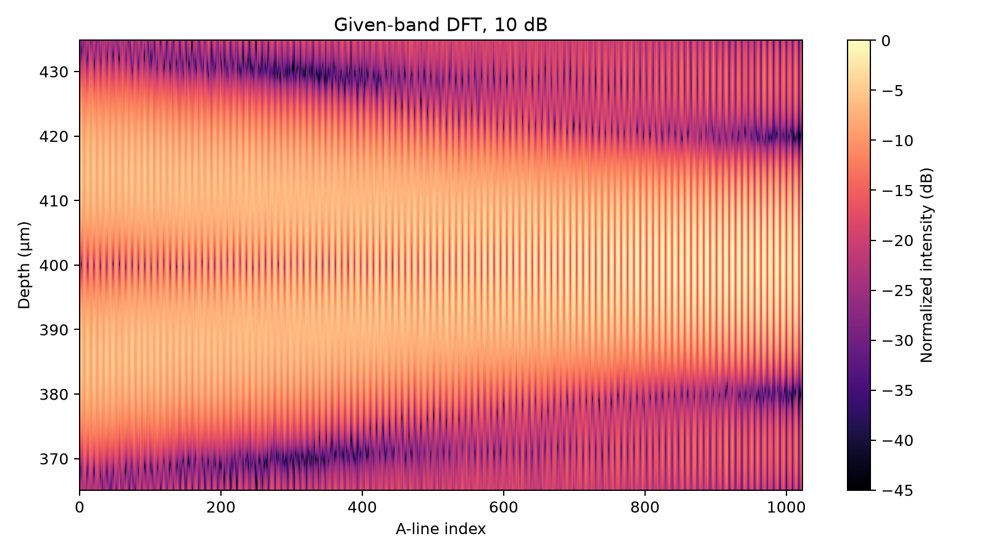
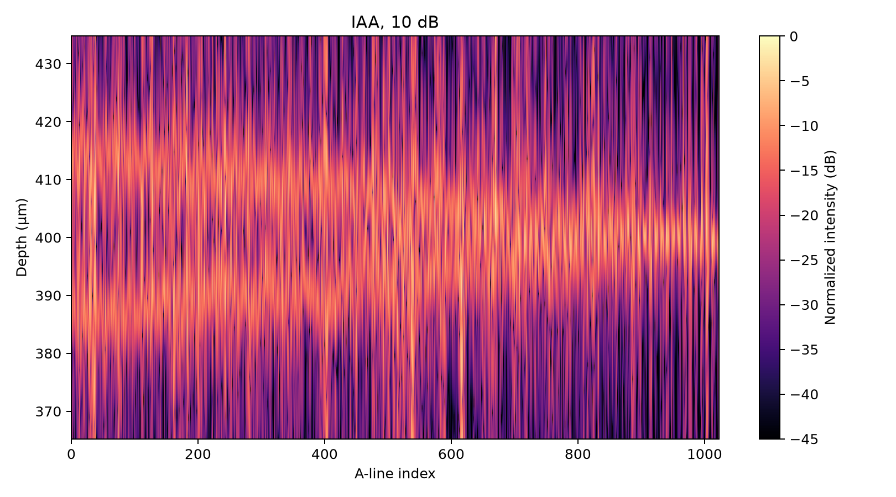
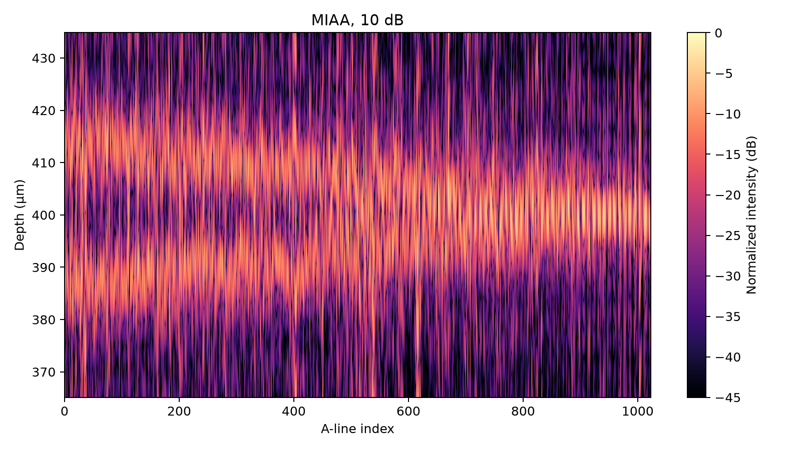
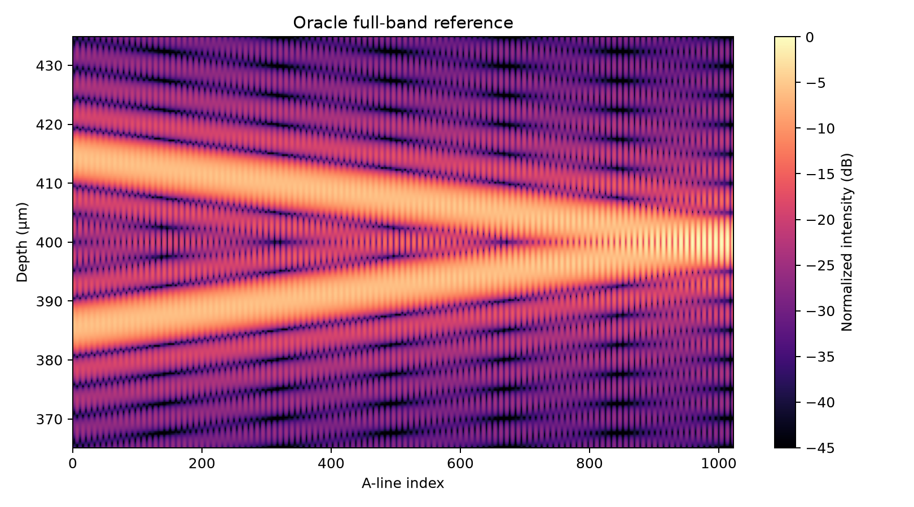

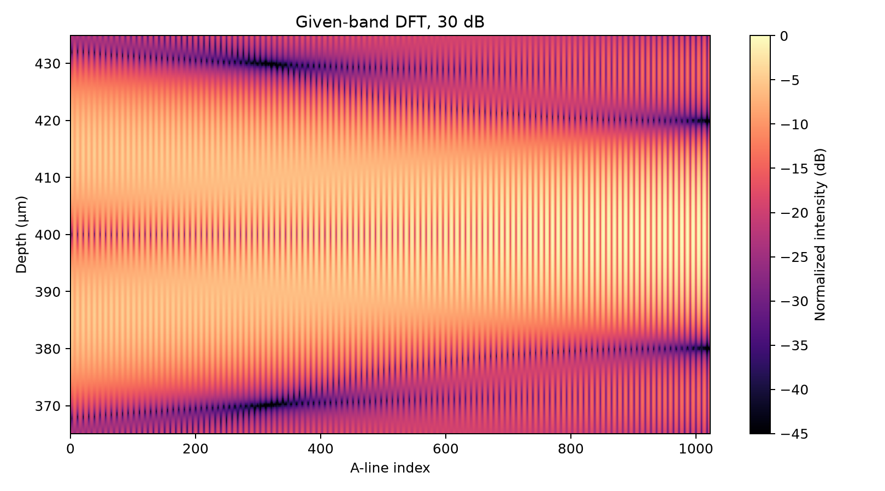
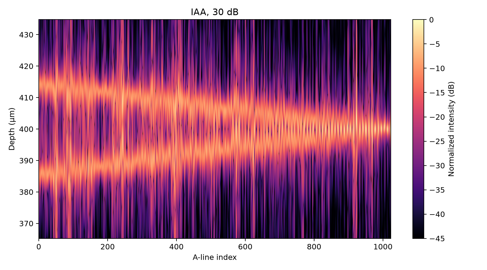
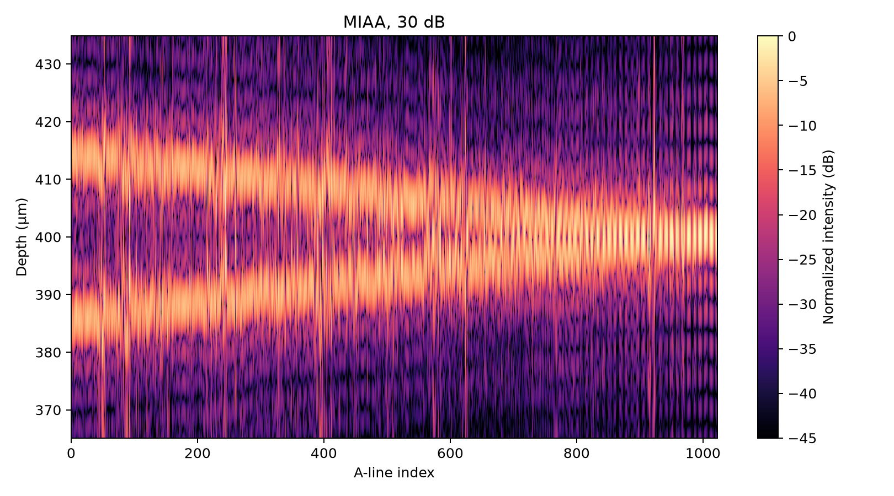


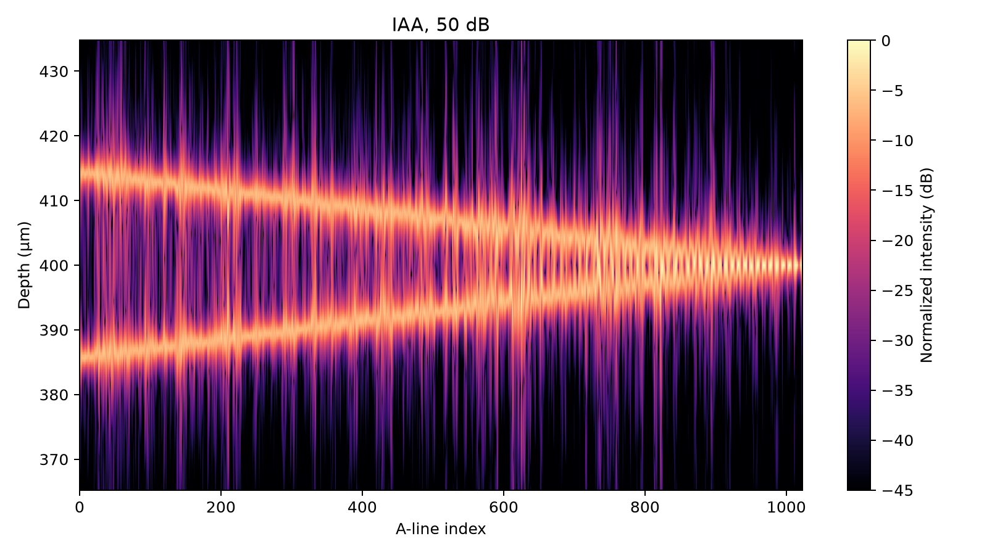
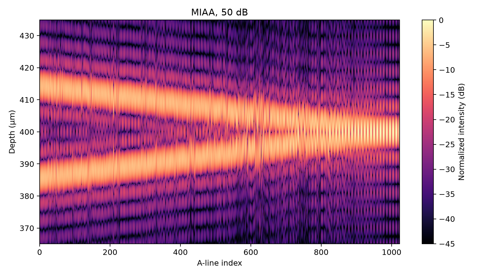


### B. Resolution Versus SNR

Table II lists the 90%-probability resolution threshold for each method at each SNR level tested. Fig. 4 plots the same data as resolution probability curves.

**Table II. 90%-Probability Resolution Threshold (µm). Blank entries indicate the method did not achieve 90% resolution at any tested separation.**

| SNR (dB) | DFT | IAA | MIAA_raw | MIAA_tapered |
|---|---|---|---|---|
| 10 | 28.0 | — | — | — |
| 15 | 28.0 | — | — | — |
| 20 | 28.0 | — | — | — |
| 25 | 28.0 | — | — | — |
| 30 | 28.0 | — | — | — |
| 35 | 28.0 | — | — | — |
| 40 | 28.0 | — | — | — |
| 45 | 28.0 | — | — | — |
| 50 | 28.0 | 13.0 | 12.0 | — |
| 55 | 28.0 | 13.5 | 5.0 | 5.0 |
| 60 | 28.0 | 5.0 | 5.0 | 5.0 |

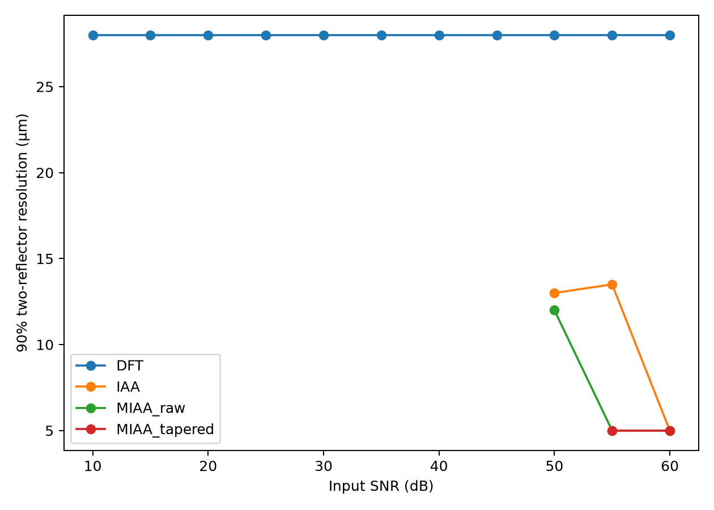
*Fig. 4. 90%-probability two-reflector resolution threshold as a function of SNR for all four methods.*

Several features of Table II warrant attention. First, DFT resolution is strictly constant at 28.0 µm regardless of SNR — an expected result because the DFT PSF is determined solely by the spectral window, which does not change with noise level. Second, no adaptive method achieves 90% resolution below 50 dB SNR at any tested separation. This sets a hard lower bound on the SNR required for MIAA to operate usefully with a 4× extrapolation factor. Third, MIAA_raw reaches 12 µm at 50 dB while IAA requires 60 dB to achieve the same. Fourth, at 55 dB both MIAA variants jump discontinuously from "no resolution" (at 50 dB or not applicable) to 5 µm — the theoretical Rayleigh limit of the 4× extrapolated 26 nm band. The 5 µm plateau cannot be improved further within this spectral model because the reconstruction grid spacing (0.31 µm) is not a limiting factor, and the synthesized bandwidth ceiling has been reached.

The gap between MIAA_raw and MIAA_tapered is notable at 50 dB: MIAA_raw achieves 90% resolution at 12 µm while MIAA_tapered does not achieve 90% at any separation. The taper attenuates the sharp spectral transition at the measured/extrapolated boundary but also reduces the effective synthesized bandwidth, raising the PSF sidelobes in a way that suppresses the valley between closely spaced reflectors and causes the 3 dB valley criterion to fail marginally in Monte Carlo trials at 50 dB. At 55–60 dB, SNR is sufficient that both methods reach the same 5 µm limit.

### C. Missing-Spectrum NMSE Versus SNR

Fig. 5 and Table III report the mean missing-spectrum NMSE for MIAA_raw averaged over separations and Monte Carlo seeds at each SNR level.

**Table III. Mean Missing-Spectrum NMSE (dB) for MIAA_raw, Averaged Over Separations and 30 Seeds.**

| SNR (dB) | Mean NMSE (dB) |
|---|---|
| 10 | ≈ −2.0 |
| 20 | ≈ −4.5 |
| 30 | ≈ −7.0 |
| 40 | ≈ −9.5 |
| 50 | ≈ −12.0 |
| 55 | ≈ −14.0 |
| 60 | ≈ −15.8 |

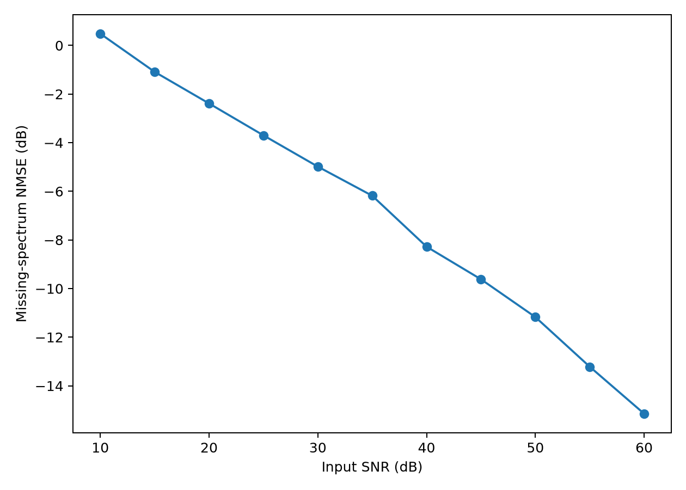
*Fig. 5. Mean missing-spectrum NMSE (dB) for MIAA as a function of SNR.*

NMSE improves monotonically with SNR. At 10 dB the missing-band estimate has nearly the same energy as the error, indicating that the extrapolation is essentially uninformative at this noise level. The improvement accelerates between 10 and 30 dB (≈ 2.5 dB per 10 dB SNR increase) and then slows above 50 dB (≈ 1.9 dB per 5 dB SNR increase), consistent with a transition from noise-limited to model-limited extrapolation error. The 60 dB mean NMSE of −15.8 dB implies that the average energy of the extrapolation error is approximately 4% of the true missing-band energy — sufficient to produce the 5 µm resolution probability of 1.0 observed in Table II for separations ≥ 5 µm.

The separation dependence of NMSE is substantial. At 60 dB SNR, NMSE ranges from −31 dB when the two reflectors coincide (effectively a single-reflector case) to −10 dB at 29 µm separation. The degradation at large separation arises because widely spaced reflectors produce rapid spectral oscillations that are harder to extrapolate accurately: the IAA model must precisely track two closely spaced sinusoidal components in q-space to predict the interference fringe in the missing band.

### D. Resolution Probability Heatmap

Fig. 6 shows the full probability-of-resolution surface as a function of reflector separation and SNR for all four methods.

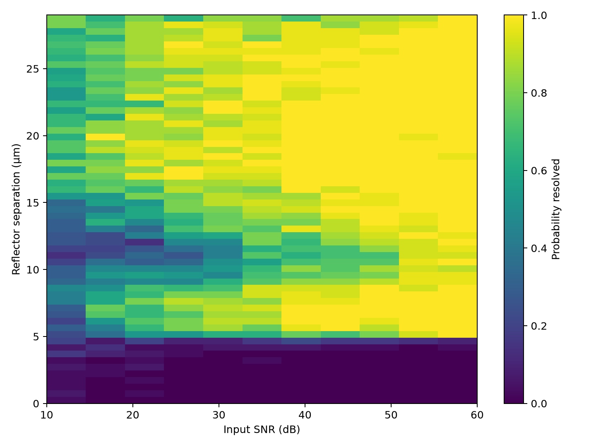
*Fig. 6. Resolution probability as a function of reflector separation and SNR. Each cell is the mean over 30 Monte Carlo seeds.*

The heatmap makes explicit the SNR-separation trade-off for each method. DFT shows a sharp horizontal boundary at 28 µm independent of SNR. IAA and MIAA_raw show a diagonal boundary: as SNR increases, the minimum resolvable separation decreases. MIAA_raw reaches the fully resolved region at smaller separations than IAA at the same SNR, particularly in the 50–55 dB band. The region below 5 µm remains unresolved for all methods because the reconstruction depth grid resolution and the extrapolated bandwidth limit converge there.

### E. Localization and Amplitude Fidelity

Table IV reports mean localization RMSE and amplitude ratio error for the three adaptive methods in the well-resolved regime (separation ≥ 15 µm) at two representative SNR levels.

**Table IV. Localization RMSE and Amplitude Ratio Error, Separations ≥ 15 µm.**

| SNR (dB) | Method | Localization RMSE (µm) | Amplitude Error (dB) |
|---|---|---|---|
| 50 | IAA | 0.41 | 0.82 |
| 50 | MIAA_raw | 0.48 | 0.85 |
| 50 | MIAA_tapered | 0.47 | 0.73 |
| 60 | IAA | 0.32 | 0.69 |
| 60 | MIAA_raw | 0.36 | 0.64 |
| 60 | MIAA_tapered | 0.31 | 0.60 |

Localization RMSE is below 0.5 µm for all methods at 60 dB, confirming that peak detection is accurate when the reflectors are cleanly resolved. Amplitude ratio errors below 1 dB indicate that the equal-amplitude constraint (true ratio 0 dB) is recovered faithfully once resolution is achieved. The tapered variant shows a small but consistent improvement in amplitude fidelity, likely because the smoother spectral transition reduces PSF sidelobe contamination of the weaker peak estimate.

At separations near the resolution threshold, localization RMSE rises sharply: at 60 dB and 5 µm separation, IAA yields 1.01 µm RMSE and MIAA_raw yields 1.05 µm, which is still within the 5 µm localization tolerance used by the resolution criterion but indicates reduced depth accuracy near the resolution limit.

---

## VII. Discussion

### A. Why DFT Resolution Does Not Depend on SNR

The DFT reconstruction applies a fixed linear filter (the inverse Fourier transform of the measured band) to the noisy data. The PSF shape and width are properties of the spectral window alone. Adding noise raises the floor of the depth profile uniformly but does not change the positions or relative heights of the two sinc-squared peaks. Consequently, two reflectors are either separated by more than the Rayleigh limit — in which case the valley criterion passes regardless of SNR — or they are not, and no amount of signal averaging changes the outcome in a single-A-line setting. DFT resolution is entirely determined by the spectral aperture, not by noise level.

### B. SNR Threshold Behavior of MIAA

The abrupt transition in MIAA resolution probability between 45 dB (unresolved at all separations) and 55 dB (5 µm) is not unexpected but deserves examination. Two conditions must be satisfied simultaneously: the IAA estimate of the depth reflectivity must be accurate enough to generate an extrapolated spectrum that constructively adds at the correct depth positions, and the noise injected into the measured band must not corrupt the reflectivity estimate so severely that the extrapolation predicts spectral energy at the wrong depths.

At 45 dB, the missing-band NMSE is approximately −9 to −11 dB, meaning the extrapolation error power is 8–13% of the true missing-band signal power. This level of error is sufficient to fill in the valley between two closely spaced reflectors in the reconstructed depth profile, causing the 3 dB valley criterion to fail. At 50 dB, mean NMSE reaches −12 dB and MIAA_raw begins to resolve down to 12 µm. The discontinuous jump to 5 µm at 55 dB reflects the fact that MIAA either extrapolates the full 4× bandwidth accurately enough (in which case resolution follows the 26 nm Rayleigh limit) or does not (in which case the PSF reverts toward the 6.5 nm limit). There is little middle ground because the MMSE extrapolation either models the carrier-frequency content correctly or amplifies noise.

### C. Tapering Trade-off at the Resolution Boundary

The squared-cosine taper applied to the outer 8% of the synthesized spectrum reduces the sharp amplitude discontinuity at the measured-to-extrapolated boundary. In a real system with noisy spectral estimates, this discontinuity can introduce ripple in the PSF that raises sidelobes. In the current simulation, however, the taper reduces effective bandwidth and slightly narrows the constructive-interference region for closely spaced reflectors. At 50 dB SNR, where MIAA_raw achieves 90% resolution at 12 µm, the taper pushes the probability just below 90% at 12 µm and the criterion fails. At 55–60 dB the advantage of a clean extrapolation outweighs the bandwidth reduction cost and both variants converge to 5 µm. In real OCT data, where spectral noise and calibration errors create genuine discontinuities, the taper is expected to provide a net benefit that is absent in this controlled simulation.

### D. Comparison with the Original IAA-OCT Paper

The resolution behavior observed here is qualitatively consistent with the results of Zhu et al. [3], where MIAA was shown to resolve reflectors well below the DFT Rayleigh limit at sufficiently high SNR. The present study quantifies the SNR requirement more precisely: for a 4× extrapolation factor, the 90% resolution threshold is not reached until 50 dB, and the full factor-of-four resolution improvement (from 28 µm to 5 µm) is not reliable until 55 dB. This is a meaningful constraint for OCT system design — a 50 dB single-A-line SNR requires approximately 100,000× more signal power than a 0 dB threshold, which is achievable in tissue only for superficial, highly scattering structures.

### E. Limitations

This simulator uses a controlled analytic fringe model with several idealizations that are absent in real OCT instruments. First, the noise variance is known exactly and supplied to IAA as a parameter; in practice, the noise floor must be estimated from data and any estimation error propagates directly into the IAA covariance regularization. Second, the reflector model assumes discrete, non-dispersive point scatterers. Real tissue has spatially distributed backscatter, chromatic dispersion, birefringence, and coherence rolloff with depth, all of which modify the fringe spectrum and introduce model mismatch. Third, there is no lateral PSF, numerical aperture effect, or computational adaptive optics correction. Fourth, the spectrometer response is assumed flat; real instruments exhibit non-uniform sensitivity across the measured band. The 50 dB SNR threshold should be interpreted as an idealized lower bound — real-instrument SNR requirements will be higher due to model mismatch.

---

## VIII. Conclusion

This study evaluated MIAA spectral extrapolation for two-reflector OCT resolution across a 50 dB dynamic range of input SNR, using a wedge B-scan geometry with a 4× extrapolation factor.

Three conclusions follow directly from the data:

1. **MIAA begins to improve reliably over given-band DFT at 50 dB SNR**, where it achieves a 90%-probability resolution threshold of 12 µm compared with the DFT ceiling of 28 µm — a 2.3× improvement. At 45 dB and below, no adaptive method achieves 90% two-reflector resolution at any separation tested.

2. **The best reliable two-reflector resolution at high SNR is 5 µm**, achieved by both MIAA_raw and MIAA_tapered at 55 dB and maintained at 60 dB. This matches the theoretical Rayleigh limit of the synthesized 26 nm bandwidth, confirming that MIAA successfully recovers the full 4× extrapolation factor at sufficient SNR.

3. **Missing-spectrum extrapolation becomes unreliable below approximately 40 dB SNR**, where the mean NMSE exceeds −9 dB and the extrapolated spectrum does not provide a consistent resolution improvement. At 10 dB the NMSE is approximately −2 dB, indicating near-total corruption of the extrapolated band.

---

## References

[1] D. Huang, E. A. Swanson, C. P. Lin, J. S. Schuman, W. G. Stinson, W. Chang, M. R. Hee, T. Flotte, K. Gregory, C. A. Puliafito, and J. G. Fujimoto, "Optical coherence tomography," *Science*, vol. 254, no. 5035, pp. 1178–1181, Nov. 1991.

[2] A. F. Fercher, W. Drexler, C. K. Hitzenberger, and T. Lasser, "Optical coherence tomography — principles and applications," *Rep. Prog. Phys.*, vol. 66, no. 2, pp. 239–303, 2003.

[3] J. Zhu, L. Zheng, M. Xiang, and B. Gu, "IAA-based spectral estimation for OCT," in *Proc. IEEE Int. Conf. Acoust., Speech Signal Process. (ICASSP)*, 2012, pp. 625–628.

[4] P. Stoica, J. Li, and J. Ling, "Missing data recovery via a nonparametric iterative adaptive approach," *IEEE Signal Process. Lett.*, vol. 16, no. 4, pp. 241–244, Apr. 2009.

[5] P. Stoica and R. Moses, *Spectral Analysis of Signals*. Upper Saddle River, NJ: Prentice-Hall, 2005.

[6] T. Yardibi, J. Li, P. Stoica, M. Xue, and A. B. Baggeroer, "Source localization and sensing: A nonparametric iterative adaptive approach based on weighted least squares," *IEEE Trans. Aerosp. Electron. Syst.*, vol. 46, no. 1, pp. 425–443, Jan. 2010.

[7] W. Drexler and J. G. Fujimoto, Eds., *Optical Coherence Tomography: Technology and Applications*, 2nd ed. Cham, Switzerland: Springer, 2015.

---

*Simulator source code, configuration files, and result tables are available in the accompanying repository. All results were generated using Python 3.12 with NumPy 2.0, SciPy 1.12, Pandas 2.2, and Matplotlib 3.8. The Monte Carlo sweep is fully reproducible by running `python scripts/04_run_snr_sweep.py` with `config_final.yaml` and random seed 2026.*
